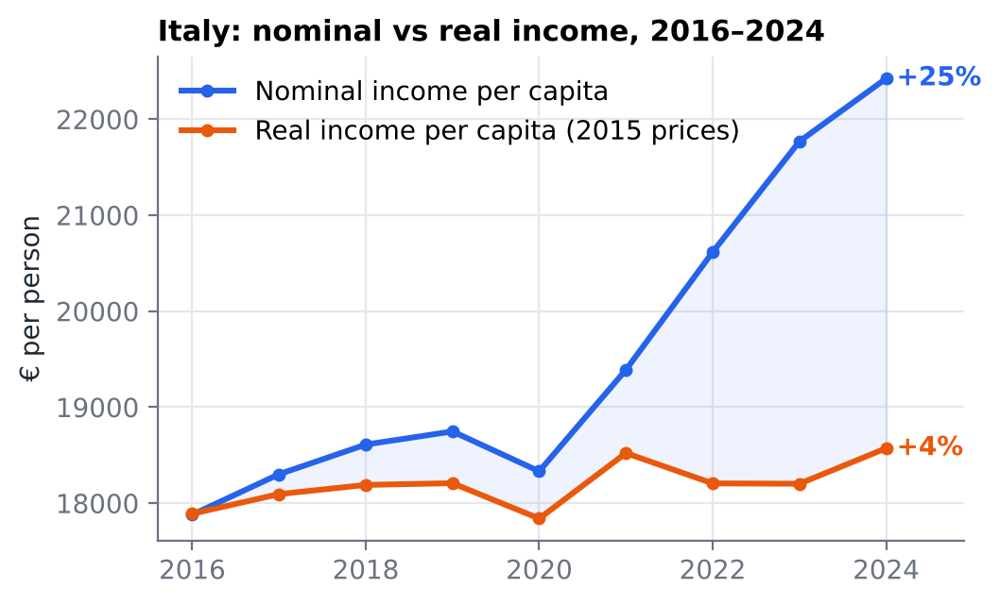
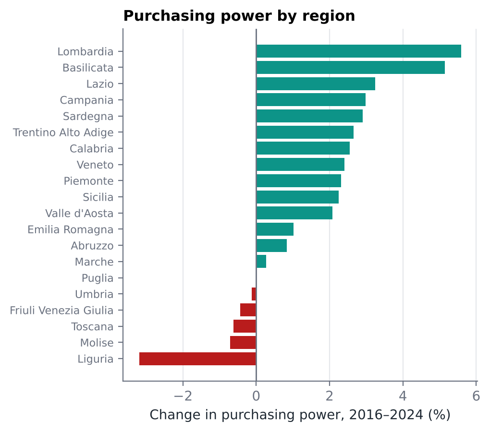

# Evolution of Purchasing Power in Italy (2016–2024)

**Nominal income +25%, real income +4% · a stable North–South gap · PCA, clustering and regional maps on ISTAT and Eurostat data**

📄 [English summary (3 pages)](purchasing_power_summary_EN.pdf) · full report in Italian: [`potere_d'acquisto.pdf`](potere_d'acquisto.pdf)

## Research question

How did the purchasing power of Italian households change between 2016 and 2024, a period that includes the COVID-19 recession and the 2022–2023 inflation shock? Did these shocks narrow or widen the long-standing gap between Northern and Southern Italy?

## Data

- **ISTAT:** household disposable income, resident population, consumer price index (NIC), unemployment, absolute and relative poverty — at national, macro-area and regional level.
- **Eurostat:** Gini index of income inequality.
- Where ISTAT does not publish a figure for the South as a whole, it was rebuilt from the South and Islands series using population weights.
- All tables are in [`dati.xlsx`](dati.xlsx) and, as CSV inputs for the script, in [`data/`](data).

## Methods

1. **Derived indicators:** per-capita and real (inflation-adjusted) income, inflation rates, growth rates and CAGR, a composite well-being indicator.
2. **Convergence analysis:** β-convergence (do poorer areas grow faster?) and σ-convergence (does dispersion shrink?), Mann–Kendall trend tests.
3. **Association:** Pearson correlations between income, unemployment and poverty.
4. **Multivariate analysis:** principal component analysis; k-means and hierarchical clustering of macro-areas and regions.
5. **Maps:** regional choropleths in R (sf, tmap) and QGIS.

## Key results

**1. Growth was almost entirely nominal.** Income per person rose from about €17,900 to €22,400, but in real terms only to €18,600. The gap opened in 2022–2023, when prices rose by 8.2% and 5.6%.

<p align="center"></p>

**2. The North–South divide did not close.** Southern real income grew faster in percentage terms (CAGR 0.78% vs 0.59% in the North-West), but from such a low base that the absolute gap widened slightly, from €7,337 to €7,478. Trend tests find no significant change.

**3. Poverty spread north while unemployment fell everywhere.** Absolute poverty nearly doubled in the North-West (5.4% → 8.1%) and North-East (4.9% → 7.6%); national unemployment fell from 11.4% to 6.6%. At regional level, purchasing power changed from +5.6% in Lombardy to −3.2% in Liguria.

<p align="center"></p>

**Limitations.** The general price index understates the inflation faced by low-income households; with only four macro-areas the macro-level clustering is descriptive; the analysis identifies associations, not causes.

## How to reproduce

```bash
git clone https://github.com/SofiaMenegozzo/Evolution-of-Purchasing-Power-in-Italy.git
cd Evolution-of-Purchasing-Power-in-Italy
```

1. Install the R packages:
   ```r
   install.packages(c("dplyr", "tidyr", "ggplot2", "Kendall", "corrplot", "Hmisc", "cluster",
                      "factoextra", "NbClust", "reshape2", "gridExtra", "ggdendro", "sf", "tmap"))
   ```
2. Open R in this folder and run `analisi_potere_acquisto.R`. It reads `data/` and writes intermediate tables to `output/`.
3. For the regional maps only: download the ISTAT administrative boundaries (*Limiti amministrativi 2025*, generalised version, WGS84) and place the `Reg01012025_g` folder inside `data/`.

## Repository contents

| File | Description |
|---|---|
| `analisi_potere_acquisto.R` | Full R analysis: indicators, tests, PCA, clustering, maps |
| `data/` | Input tables (semicolon-separated CSV) |
| `dati.xlsx` | All source data and main output tables in one workbook |
| `purchasing_power_summary_EN.pdf` | 3-page summary in English |
| `potere_d'acquisto.pdf` | Full report (Italian) |
| `figures/` | Charts used in this README |

**Tools:** Python (data cleaning) · R (dplyr, ggplot2, factoextra, sf, tmap) · QGIS · Excel

**Author:** Sofia Menegozzo
